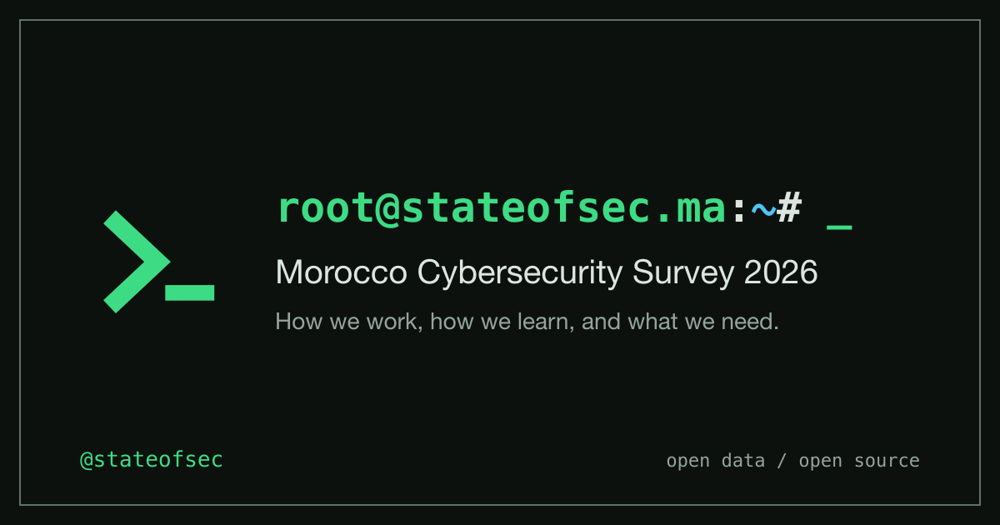

<p align="center">
  <a href="https://stateofsec.ma">
    
  </a>
</p>

# State of Sec Morocco

[stateofsec.ma](https://stateofsec.ma) is a community survey of the people who secure, test and audit Morocco's systems: how they got into security, how they work, how they learn, and what they need. The results are published as an open report, and the answers are released as open data.

Made by [saladin0x1](https://github.com/saladin0x1) and [mchklt](https://github.com/mchklt), built on [stateofdev.ma](https://stateofdev.ma) by the [GeeksBlaBla](https://geeksblabla.community) community (see [Credits](#credits)).

## Stack

- [Astro](https://astro.build/) 5, React 18 and Tailwind CSS 3
- Hosted on Cloudflare Workers through `@astrojs/cloudflare`
- Firebase anonymous sign-in in the browser; on the server, ID tokens are verified with [jose](https://github.com/panva/jose) and answers are written to Firestore through its REST API (`firebase-admin` does not run on Workers)
- Cloudflare Turnstile captcha before a survey session starts
- PostHog analytics (EU), loaded only after a visitor accepts the cookie banner

## Quick Start

Requirements: Node 22 and pnpm 11.

```sh
git clone https://github.com/saladin0x1/stateofsec.ma.git
cd stateofsec.ma
pnpm install
cp .env.example .env.local
pnpm dev
```

The site runs at `http://localhost:4321`. Static pages work without any configuration. To take the survey locally, fill in `.env.local`:

1. **Firebase**: create a project, enable **Anonymous** sign-in, and create a Firestore database in production mode. Deploy `firestore.rules` (deny all: only the server, through the service account, touches the data).
   - Web app config goes in the `PUBLIC_FIREBASE_*` variables.
   - From a service account key, copy `project_id`, `client_email` and `private_key` into `FIREBASE_PROJECT_ID`, `FIREBASE_CLIENT_EMAIL` and `FIREBASE_PRIVATE_KEY`.
2. **Session secret**: `SESSION_SECRET` signs the session cookie, at least 32 random characters (`openssl rand -base64 48`).
3. **Captcha**: optional in development. Cloudflare's test keys always pass: site key `1x00000000000000000000AA`, secret `1x0000000000000000000000000000000AA`. In production the captcha is required.
4. **Analytics**: optional. Leave `PUBLIC_POSTHOG_KEY` empty to disable PostHog and the cookie banner.

## Deploying to Cloudflare

Configuration lives in `wrangler.jsonc`. `PUBLIC_*` variables are embedded at build time, so they must be set where the build runs. Server secrets are set on the Worker:

```sh
wrangler secret put FIREBASE_PROJECT_ID
wrangler secret put FIREBASE_CLIENT_EMAIL
wrangler secret put FIREBASE_PRIVATE_KEY
wrangler secret put SESSION_SECRET
wrangler secret put TURNSTILE_SECRET_KEY
pnpm build
wrangler deploy
```

## How the Survey Works

1. `/before-start` shows the rules and the Turnstile captcha. On start, the browser signs in anonymously with Firebase and calls the `initSession` action with its ID token and the captcha token.
2. The server checks the captcha and the ID token, then sets a signed, `httpOnly` session cookie.
3. `/survey` renders the questions from `survey/*.yml`. Answers are submitted at the end of each section through the `submitAnswers` action.
4. The server validates every answer against the survey definition (valid choice indexes, `max` picks, exclusive choices), ignores question ids it does not know, and drops answers to questions hidden by `showIf` conditions before writing to Firestore. A submit only deletes stored answers of the sections up to the one being submitted.

Question ids are positional: `<section label>-q-<index>`. Inserting, removing or reordering questions in a YAML file changes the ids of every later question in that section, so freeze the survey once it is open.

To close the survey, set `SURVEY_OPEN = false` in `src/site-config.mjs`: the survey pages redirect home and the server rejects new sessions and answers.

## Results

```sh
pnpm export-results --output=<private dir>            # full private dump of Firestore responses (never commit it)
pnpm export-results --public=results/<year>/data      # coarsened public release, written only if the privacy gate passes
pnpm generate-questions --output=results/<year>/data  # questions.json from the current survey YAML
pnpm query-results                                    # query results from the CLI, see docs/query-results.md
```

Run `generate-questions` before editing the survey for the next edition, or the questions will no longer match that year's answers. The private export is a raw dump of Firestore documents, including their anonymous ids, timestamps and free text: it is for the owners only. This year only aggregates and charts are published, no row-level file; see `docs/privacy.md` for the release gate and what a row-level release needs.

## Scripts

| Command | Description |
| --- | --- |
| `pnpm dev` | Start the dev server |
| `pnpm build` | Validate the survey, type-check and build |
| `pnpm check` | Validate the survey and type-check |
| `pnpm lint` / `pnpm lint:ci` | Lint with fixes / check only |
| `pnpm test` / `pnpm test:ci` | Run tests / run with coverage |
| `pnpm validate-survey` | Validate `survey/*.yml` |

More detail in [`docs/`](./docs).

## Contributing

Suggestions for questions, bug reports and pull requests are welcome in the [issues](https://github.com/saladin0x1/stateofsec.ma/issues).

## Licensing

- Code: [MIT](./LICENSE), keeping the original copyright of the stateofdev.ma authors.
- Data in `./results`: [ODC-ODbL](https://opendatacommons.org/licenses/odbl/).

## Credits

State of Sec Morocco is built on [stateofdev.ma](https://stateofdev.ma), the annual survey of Morocco's developers run by the [GeeksBlaBla](https://geeksblabla.community) community since 2020. Their open source code and survey format made this project possible. Original repository: [geeksblabla/stateofdev.ma](https://github.com/geeksblabla/stateofdev.ma).

Thanks to the stateofdev.ma contributors:

<!-- prettier-ignore-start -->
<!-- markdownlint-disable -->
<table>
  <tbody>
    <tr>
      <td align="center" valign="top" width="16.66%"><a href="https://elazizi.com/"><br /><sub><b>Youssouf EL AZIZI</b></sub></a><br /><sub>Code, Docs, Content, Ideas</sub></td>
      <td align="center" valign="top" width="16.66%"><a href="http://aboullaite.me/"><br /><sub><b>Mohammed Aboullaite</b></sub></a><br /><sub>Code, Content, Ideas</sub></td>
      <td align="center" valign="top" width="16.66%"><a href="https://github.com/ismailElazizi"><br /><sub><b>Ismail El Azizi</b></sub></a><br /><sub>Content, Ideas, Design</sub></td>
      <td align="center" valign="top" width="16.66%"><a href="https://twitter.com/enlamp"><br /><sub><b>djalal</b></sub></a><br /><sub>Content, Ideas</sub></td>
      <td align="center" valign="top" width="16.66%"><a href="https://github.com/iMeriem"><br /><sub><b>Meriem Zaid</b></sub></a><br /><sub>Content, Ideas</sub></td>
      <td align="center" valign="top" width="16.66%"><a href="https://github.com/ezzarghili"><br /><sub><b>Mohamed Ez-zarghili</b></sub></a><br /><sub>Content, Ideas</sub></td>
    </tr>
    <tr>
      <td align="center" valign="top" width="16.66%"><a href="https://github.com/Aymane11"><br /><sub><b>Aymane Boumaaza</b></sub></a><br /><sub>Content</sub></td>
      <td align="center" valign="top" width="16.66%"><a href="https://blog.zhaytam.com/"><br /><sub><b>Haytam Zanid</b></sub></a><br /><sub>Content</sub></td>
      <td align="center" valign="top" width="16.66%"><a href="https://github.com/boredabdel"><br /><sub><b>Abdelfettah SGHIOUAR</b></sub></a><br /><sub>Content</sub></td>
      <td align="center" valign="top" width="16.66%"><a href="http://stackoverflow.com/users/4689497/"><br /><sub><b>Youness IABITEN</b></sub></a><br /><sub>Content</sub></td>
      <td align="center" valign="top" width="16.66%"><a href="https://github.com/Ismailtlem"><br /><sub><b>Ismail Tlemçani</b></sub></a><br /><sub>Content</sub></td>
      <td align="center" valign="top" width="16.66%"><a href="https://soubai.me/"><br /><sub><b>Abderrahim SOUBAI</b></sub></a><br /><sub>Content</sub></td>
    </tr>
    <tr>
      <td align="center" valign="top" width="16.66%"><a href="https://github.com/moutout"><br /><sub><b>Mustapha</b></sub></a><br /><sub>Content</sub></td>
      <td align="center" valign="top" width="16.66%"><a href="https://www.linkedin.com/in/sohayb-elamraoui/"><br /><sub><b>el amraoui Sohayb</b></sub></a><br /><sub>Content</sub></td>
      <td align="center" valign="top" width="16.66%"><a href="http://yezz.me"><br /><sub><b>Yasser Tahiri</b></sub></a><br /><sub>Content</sub></td>
      <td align="center" valign="top" width="16.66%"><a href="https://www.iduoad.com"><br /><sub><b>Mohammed Daoudi</b></sub></a><br /><sub>Content</sub></td>
      <td align="center" valign="top" width="16.66%"><a href="https://github.com/bilalix"><br /><sub><b>Bilal</b></sub></a><br /><sub>Code, Content</sub></td>
    </tr>
  </tbody>
</table>
<!-- markdownlint-restore -->
<!-- prettier-ignore-end -->

stateofdev.ma was itself inspired by the [Stack Overflow Developer Survey](https://insights.stackoverflow.com/survey) and the [State of Frontend](https://tsh.io/state-of-frontend/) survey.
