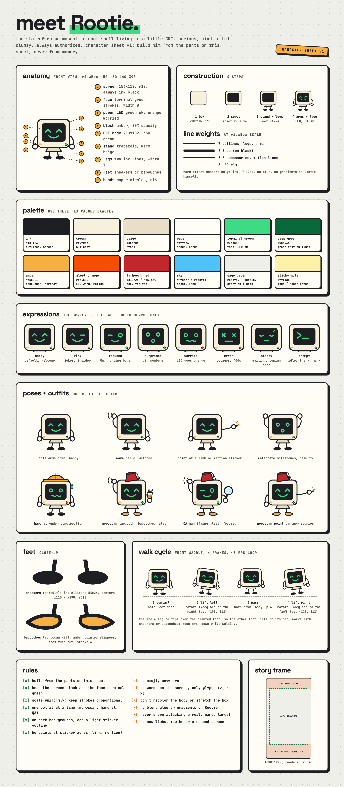
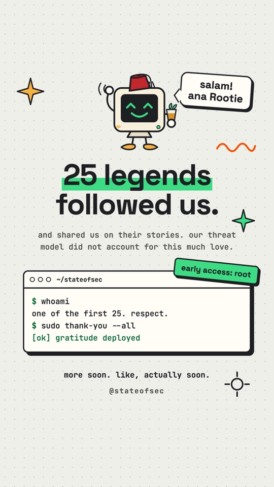
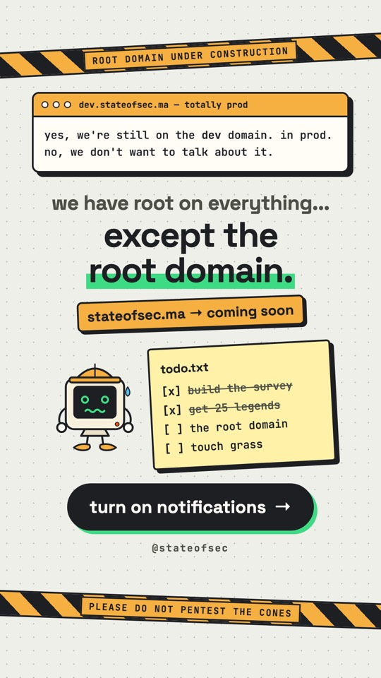
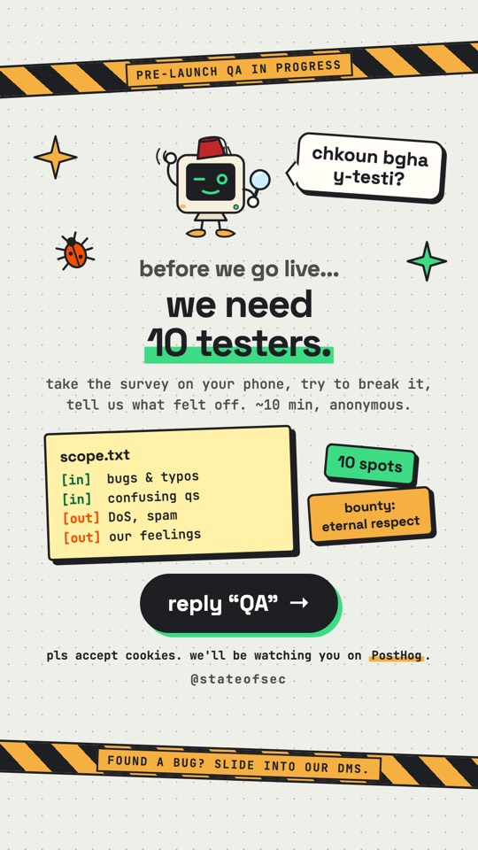
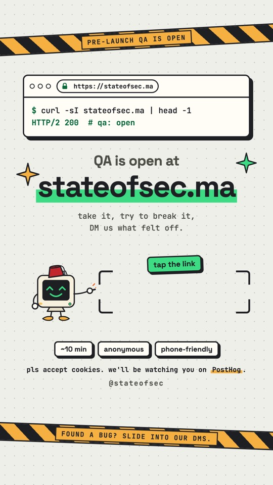
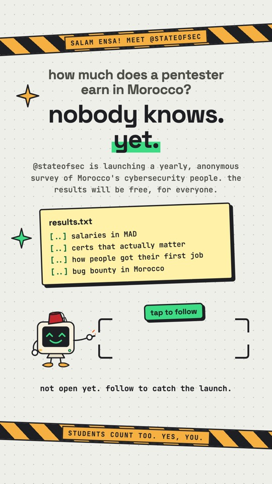
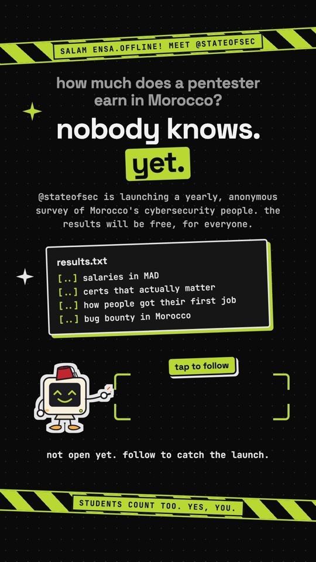

# Rootie

Rootie is the stateofsec.ma mascot: a root shell living in a little CRT. Curious, kind, a bit clumsy, and always authorized. He fronts the Instagram stories (@stateofsec) and anything else that needs a friendly face.

## Files

| Path | What it is |
| --- | --- |
| `design-sheet.html` / `.png` | The character sheet. Its `<defs>` hold the canonical parts (arms, legs, feet, body, faces, outfits): build every new pose from them |
| `svg/` | Standalone poses, ready to drop into a design tool or a page |
| [`../stories/`](../stories/) | The story kit and templates he appears in |

## Anatomy

All measurements are in the drawing's own units (viewBox `-50 -30 440 390`), so they scale with him.

| Part | Spec |
| --- | --- |
| CRT body | Rounded rect 210x182, radius 30, cream `#f7f0dc`, ink outline 7 |
| Screen | 156x118, radius 18, inset 27 / 26, always ink black `#1e1f23` |
| Face | Terminal green `#3ddc84` strokes, width 8, drawn on the screen |
| Power LED | Circle r7 at the bottom right: green when fine, orange `#f54e00` when worried |
| Blush | Amber ellipse at the bottom left, 80% opacity |
| Stand | Beige `#e8dfc6` trapezoid under the box |
| Legs | Two ink lines, width 7 |
| Feet | Sneakers (ink ellipses 54x24) by default, amber babouches in the Moroccan kit |
| Hands | Paper `#fffdf6` circles, radius 16 |

## Palette

| Name | Hex | Used for |
| --- | --- | --- |
| Ink | `#1e1f23` | Outlines, screen, text, hard shadows |
| Cream | `#f7f0dc` | CRT body |
| Beige | `#e8dfc6` | Stand |
| Paper | `#fffdf6` | Hands, terminal windows, speech bubbles |
| Terminal green | `#3ddc84` | Face, LED, highlighter marks |
| Deep green | `#08693a` | Green text on light backgrounds (passes AA) |
| Amber | `#f5b041` | Babouches, hardhat, blush, caution tape |
| Alert orange | `#f54e00` | Worried LED, motion lines, "out of scope" |
| Tarbouch red | `#c1272d` / `#a51f24` | Fez and its top |
| Sky | `#4fc3f7` / `#cdeffd` | Sweat drop, magnifying glass |
| Sage paper | `#eeefe9` + `#bfc1b7` dots | Story background |
| Sticky note | `#fff1a8` | `todo.txt`, `scope.txt`, `results.txt` notes |

## Expressions

The screen is his whole face, and it only ever shows green glyphs: no words.

| Face | Use it for |
| --- | --- |
| happy (`^ ^` + smile) | The default: welcome, thanks, follow |
| wink | Jokes and insider asides |
| focused (squint + wide eye) | QA, bug hunting, "we're checking" |
| surprised (`o o` + O mouth) | Big numbers, milestones |
| worried (`o o` + wavy mouth, orange LED) | Delays, construction, "please don't" |
| error (`x x`, orange LED) | Outages, 404s |
| sleepy (`- -` + z) | Waiting, coming soon |
| prompt (`>_`) | Idle; it is also the site's favicon mark |

## Poses and Outfits

Poses: idle, wave, point, celebrate. Outfits: plain, hardhat (with the worried face and a sweat drop), Moroccan (tarbouch, babouches, a glass of atay), QA (Moroccan with a magnifying glass). Wear one outfit at a time; `svg/rootie-hardhat-moroccan.svg` is the one allowed combo.

When a story has a link or mention sticker, Rootie points at it (`arm-r-point`) from the left of the sticker zone.

## Feet and Walk Cycle

Sneakers are the default; babouches come with the Moroccan kit. The walk is a front-facing waddle in 4 frames at about 8 fps:

1. Contact: both feet down
2. Lift left: rotate the whole figure +7 degrees around the right foot (190, 318)
3. Pass: both feet down, body up 6
4. Lift right: rotate -7 degrees around the left foot (110, 318)

Tipping the whole figure over the planted foot lifts the other one by itself, so no leg has to be redrawn.

## Making a Story

1. Copy the closest template in `stories/` and keep `fun.css` next to it.
2. Keep everything inside the safe zone: 250px free at the top and 340px at the bottom of the 1080x1920 frame, for Instagram's own UI.
3. One message and one call to action per story. If the CTA is a link or a mention, leave an empty zone with corner brackets for the Instagram sticker, and have Rootie point at it.
4. Render from the branch root: `./render.sh stories/my-story.html ~/Desktop/my-story.png` (1080x1920 at 3x by default).
5. Look at the PNG before posting: nothing overlapping, nothing cut off, no stray line breaks.

### Kit Components (`stories/fun.css`)

| Class | What it draws |
| --- | --- |
| `.safe` | The centered safe-zone column every story builds in |
| `.h1`, `.mark`, `.mark-amber` | Space Grotesk headlines and the highlighter mark |
| `.sub` | Mono body text |
| `.win` (`.tb`, `.bd`, `.prompt`) | A terminal window with a title bar |
| `.sticker` | A small tilted label with a hard shadow |
| `.btn` | The pill-shaped call to action |
| `.tape` | Caution tape across the top or bottom |
| `.handle` | The `@stateofsec` signature |

Notes (`todo.txt`, `scope.txt`, `results.txt`) and sticker zones are defined in the templates that use them.

### Voice

- Lowercase, short, warm. Terminal jokes land well with this audience: `whoami`, `sudo`, `curl -I`, `scope.txt`.
- A touch of Darija is welcome ("salam!", "chkoun bgha y-testi?"). Keep the main message in English, like the site.
- Be exact about the survey's status: say "not open yet" or "drops soon" before launch, and send people to the survey only when it is open.
- Never use emoji, in copy or in markup.

### Partner Palettes

`stories/partner-intro-dark.html` shows how to restyle a story for a partner page: override the CSS variables, turn the highlights and tapes to the partner's colors, and give Rootie a light die-cut outline (the `#sticker` SVG filter) so his ink lines read on a dark background. His body never changes color; for partners his face may take the partner's accent.

## Templates

| | | |
| --- | --- | --- |
|  |  |  |
| `welcome.html`: thank the first followers | `coming-soon.html`: teaser (outdated copy, kept as a layout) | `qa-call.html`: recruit testers |
|  |  |  |
| `qa-link.html`: link sticker zone | `partner-intro.html`: shoutout with a mention sticker | `partner-intro-dark.html`: the same, in a partner palette |
